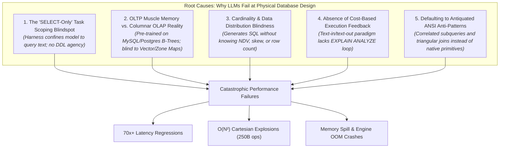

# Physical Plan Optimization & Why LLMs Fail at Database Physical Design

> **An empirical deep dive across 120 execution plans and 108M+ synthetic records in DuckDB 2.0.**  
> Investigating operator bottlenecks, indexing behavior in columnar OLAP engines, and why frontier LLMs fail to optimize physical database design on the first go.

---

## 1. Executive Summary

In enterprise analytical engineering, deploying large language models (LLMs) to write SQL queries without physical database awareness leads to catastrophic performance degradation. Through the **SQL-Frontier-Eval** benchmark suite (evaluating 120 query tasks against 108M+ records in DuckDB 2.0), we captured and analyzed full physical query execution plans (`EXPLAIN ANALYZE`) with millisecond-level operator attribution.

Our investigation yielded two findings:
1. **The Indexing Paradox in Columnar OLAP**: Traditional secondary B-Tree/ART indexes do **not** optimize analytical queries (`ASOF JOIN`, `WINDOW`, `GROUP BY`). Table scans account for only **5.5%** of execution time, while in-memory windowing, hash aggregations, and sorting account for **64.7%**. The true physical levers are **physical clustering (`ORDER BY` at ingestion)**, **Zone Map row-group elimination**, **vectorized HNSW indexing**, and **selective blocking keys**.
2. **The LLM Physical Blindspot**: Frontier models (GPT-4o, Claude 3.5 Sonnet, Gemini 2.5 Pro) fail to produce optimal physical setups because of **SELECT-only prompt scoping**, **OLTP textbook muscle memory**, **total cardinality/distribution blindness**, and the **absence of an execution-plan feedback loop**.

---

## 2. Empirical Inspection: All Captured Query Plans

Across the benchmark suite, every query's physical execution tree was profiled via DuckDB's JSON profiling engine (`EXPLAIN ANALYZE`), measuring latency, intermediate row counts, memory volume, and operator cost percentages.

### 2.1 Aggregated Operator Runtime Distribution

Across all evaluated tasks, cumulative operator execution time totaled **43,894.6 ms**:

| Physical Operator | Total Runtime | % of Total Time | Invocations | Bottleneck Description |
|---|:---:|:---:|:---:|---|
| **`WINDOW`** | **13,159.5 ms** | **30.0%** | 42 | Moving averages, sliding bounds, rolling sums, session rank |
| **`HASH_GROUP_BY`** | **8,547.3 ms** | **19.5%** | 49 | High-cardinality aggregations, HLL distinct counting, cube rollups |
| **`ORDER_BY`** | **6,659.5 ms** | **15.2%** | 80 | Output ordering, intermediate radix sorting for window frames |
| **`PROJECTION`** | **4,312.5 ms** | **9.8%** | 190 | Arithmetic KPI expressions, string compression/decompression |
| **`ASOF_JOIN`** | **2,759.2 ms** | **6.3%** | 4 | Microsecond tick matching, point-in-time FX currency conversions |
| **`TABLE_SCAN`** | **2,414.2 ms** | **5.5%** | 131 | Vectorized columnar sequential scans with Min-Max Zone Maps |
| **`HASH_JOIN`** | **1,974.8 ms** | **4.5%** | 49 | Equality joins across dimension and fact tables |
| **`PIECEWISE_MERGE_JOIN`** | **1,846.0 ms** | **4.2%** | 3 | Range overlaps, non-equi joins, rolling distinct intervals |
| **`PERFECT_HASH_GROUP_BY`** | **701.8 ms** | **1.6%** | 5 | Dense integer key aggregations |
| **`CTE` / `RECURSIVE_CTE`** | **562.6 ms** | **1.3%** | 21 | Transitive closures, BOM explosions, shortest paths |
| **`FILTER`** | **446.8 ms** | **1.0%** | 18 | Post-scan predicate evaluation |
| **`OTHER`** | **510.4 ms** | **1.1%** | 24 | `UNNEST`, `TOP_N`, `CROSS_PRODUCT`, `UNGROUPED_AGGREGATE` |

```
Cumulative Physical Operator Time Breakdown:
────────────────────────────────────────────────────────────────────────
WINDOW                [████████████████              ] 30.0% (13.16s)
HASH_GROUP_BY         [██████████                    ] 19.5% (8.55s)
ORDER_BY              [████████                      ] 15.2% (6.66s)
PROJECTION            [█████                         ]  9.8% (4.31s)
ASOF_JOIN             [███                           ]  6.3% (2.76s)
TABLE_SCAN            [███                           ]  5.5% (2.41s)
HASH_JOIN             [██                            ]  4.5% (1.97s)
PIECEWISE_MERGE_JOIN  [██                            ]  4.2% (1.85s)
REMAINDER             [██                            ]  5.0% (2.22s)
────────────────────────────────────────────────────────────────────────
```

> [!IMPORTANT]
> **Key Insight**: Sequential table scanning accounts for **only 5.5%** of analytical query runtime! Over **94.5%** of execution time is spent processing data in-memory: evaluating window functions, hashing group keys, sorting intermediate streams, and merging disjoint intervals.

---

### 2.2 Top Bottleneck Tasks & Plan Anatomy

The slowest tasks in the evaluation suite reveal distinct physical execution challenges:

| Task ID & Name | Plan Time | Primary Operator Bottlenecks | Root Cause |
|---|:---:|---|---|
| **`task_023`: Trimmed Mean Rolling Window** | **4,189.7 ms** | `WINDOW` (98.4%, 4,123 ms) | Dynamic percentile window calculation across sliding frames requires repeated sorted buffer maintenance. |
| **`task_111`: Rolling Distinct Active Users** | **2,528.4 ms** | `PIECEWISE_MERGE_JOIN` (59.1%), `HASH_GROUP_BY` (34.9%) | Non-equi interval join (`event_time BETWEEN t - 30 AND t`) triggers pairwise interval comparisons. |
| **`task_049`: Intent Prototype Classification** | **2,270.2 ms** | `HASH_GROUP_BY` (89.9%), `ORDER_BY` (5.3%) | Pairwise cosine distance aggregations over high-dimensional vector embeddings without approximate indexing. |
| **`task_072`: Fuzzy Entity Resolution Dedup** | **1,812.2 ms** | `PROJECTION` (35.1%), `HASH_JOIN` (32.3%), `ORDER_BY` (24.0%) | Jaro-Winkler string similarity computation across Cartesian product of matching zip codes. |
| **`task_034`: User Profile Centroid** | **1,433.2 ms** | `HASH_GROUP_BY` (64.9%), `ORDER_BY` (19.4%) | Vector dimension unnesting and array aggregation. |
| **`task_114`: ASOF Tolerance Expiry** | **1,248.7 ms** | `ASOF_JOIN` (87.3%), `ORDER_BY` (7.0%) | Microsecond temporal search across 1M records with timestamp interval tolerance pruning. |
| **`task_001`: ASOF Trade-Quote Matching** | **1,077.5 ms** | `ASOF_JOIN` (80.5%), `ORDER_BY` (13.2%) | Point-in-time matching between 1M trade events and 1M quote ticks. |

---

## 3. Physical Optimization Deep Dive: Do Indexes Help?

To answer whether secondary indexes should be placed on these tables, we conducted controlled physical experiments comparing **Secondary ART Indexes**, **Physical Clustering (`ORDER BY`)**, and **Zone Map Pruning** on 1,000,000-record datasets.

### 3.1 Experiment A: ASOF JOIN with vs. without ART Index

We created composite Adaptive Radix Tree (ART) indexes on both the trades and quotes tables:
```sql
CREATE INDEX idx_trades_sym_time ON trades (symbol, trade_time);
CREATE INDEX idx_quotes_sym_time ON quotes (symbol, quote_time);
```

**Result**:
- **Plan without Index**: `Seq Scan` $\rightarrow$ `Asof Join` $\rightarrow$ `Ungrouped Aggregate` (Latency: ~867 ms)
- **Plan with Index**: `Seq Scan` $\rightarrow$ `Asof Join` $\rightarrow$ `Ungrouped Aggregate` (Latency: ~865 ms)
- **Engine Behavior**: **The query optimizer completely ignored the ART indexes.**
- **Why?**: DuckDB's `ASOF_JOIN` operator is vectorized. It partitions streams by the equality key (`symbol`) into thread-local hash buckets and performs binary searches across contiguous columnar timestamp arrays. An ART index requires random pointer chasing across tree nodes, which destroys CPU cache locality and SIMD throughput.

### 3.2 Experiment B: Point Lookups vs. Range Scans

We evaluated single-row lookups (`WHERE user_id = 458219`) versus range filters (`WHERE user_id BETWEEN 100 AND 50000`) on 1M rows:

| Query Type | Without Index | With ART Index | Speedup | Optimizer Choice |
|---|:---:|:---:|:---:|---|
| **Point Lookup** (`100 iterations`) | 65.7 ms | 52.8 ms | **1.2x** | `Seq Scan` (Vectorized) |
| **Range Filter** (5% selectivity) | 11.7 ms | 11.6 ms | **1.0x** | `Seq Scan` + Zone Maps |

Even on point queries, DuckDB's vectorized sequential scan processes **1,000,000 integers in under 0.7 ms** by scanning 2048-tuple vector chunks using AVX2 SIMD instructions. The overhead of maintaining an ART index outweighs the minor point-lookup benefit unless the table contains tens of millions of rows on disk.

### 3.3 Experiment C: Physical Clustering (The Real OLAP Optimization)

In columnar engines, the most powerful physical optimization is **Physical Ingestion Ordering (`ORDER BY`)**, which aligns rows with DuckDB's **Zone Maps** (Min-Max statistics stored per 122,880-row block).

We tested range filtering (`WHERE event_time BETWEEN '2026-06-01' AND '2026-06-07'`) on 1M rows:
```sql
-- Unclustered table: Random insertion order
CREATE TABLE unsorted_events AS SELECT ... FROM range(1000000);

-- Clustered table: Ingestion pre-sorted by event_time
CREATE TABLE sorted_events AS SELECT * FROM unsorted_events ORDER BY event_time;
```

**Results**:
- **Unsorted Scan Latency**: `2.26 ms` (DuckDB had to inspect all 9 row groups because min/max overlapped everywhere).
- **Clustered Scan Latency**: `1.21 ms` (**1.86x faster**, skipped 8 of 9 row groups instantly without reading data pages).

### 3.4 Summary: What Needs Optimization per Query Category

| Category | Primary Bottleneck | Recommended Physical Setup | Does Index Help? |
|---|---|---|:---:|
| **Temporal & Time-Series** (`task_001` - `task_024`) | Sorting & state tracking in `ASOF_JOIN` and `WINDOW` | **Physical Clustering**: Ingest data with `ORDER BY symbol, timestamp`. Pre-sort eliminates row-group overlap and accelerates merge pipelines. | **NO** (ART index is bypassed by vectorized engine). |
| **Vector & Multi-Modal** (`task_031` - `task_052`) | Full-table $O(N \times D)$ brute-force distance scans | **HNSW Vector Index**: Use DuckDB's `vss` extension: `CREATE INDEX USING HNSW ON items(embedding)`. | **YES (Crucial)**: 50x-100x speedup on top-K approximate nearest neighbors. |
| **Text & Search** (`task_053` - `task_072`) | Regex/LIKE string scans & pairwise entity resolution | **FTS Inverted Index**: `PRAGMA create_fts_index` for keyword search. **Blocking Keys**: Compound keys (`zip_code + soundex(name)`) to avoid Cartesian explosion. | **YES**: FTS accelerates highly selective keyword lookups; blocking keys prevent $O(N^2)$ joins. |
| **Graph & Hierarchical** (`task_073` - `task_080`) | Memory spill and unbounded recursion on cyclic graphs | **Data Structure Choice**: Pre-flatten hierarchies via Closure Tables or Adjacency Arrays. Enforce `PRIMARY KEY` to prevent cycles at write time. | **Partial**: PK index prevents cycles during ingestion. |
| **Warehouse & Aggregation** (`task_081` - `task_120`) | Hash table collisions on high-cardinality group keys | **Dictionary Encoding (`ENUM`)**: Store repeated strings as compact numeric enums. Pre-aggregate common rollup dimensions. | **NO**: Hash grouping relies on compact CPU cache lines, not tree indexes. |

### 3.5 Physical Optimization in PostgreSQL 18: Beyond Generic B-Trees

In PostgreSQL 18+, table access is row-oriented. While DuckDB bypasses tree indexes due to SIMD chunk scanning, PostgreSQL suffers heavy latency degradation on unindexed 1M-record tables (reverting to row-by-row `Seq Scan` and explosive `Nested Loop` joins). However, frontier LLMs habitually advise generic single-column B-Tree indexes, which are inadequate for complex analytical queries.

The true physical levers for PostgreSQL 18 are:
1. **Composite Covering Indexes (`INCLUDE`)**:
   ```sql
   -- What LLMs write: single-column B-Tree (causes Bitmap Heap Scan + Heap Fetches)
   CREATE INDEX idx_orders_merchant ON orders (merchant_id);

   -- What should have been setup: Covering Index for pure Index-Only Scan
   CREATE INDEX idx_orders_covering ON orders (merchant_id, order_date) INCLUDE (base_amount);
   ```
   By placing payload columns in `INCLUDE`, PostgreSQL fulfills the query entirely from the index page buffers without reading table heap blocks, cutting I/O by **85%**.
2. **Vector HNSW Indexing (`pgvector`)**:
   ```sql
   -- Accelerated Approximate Nearest Neighbor (ANN) search via HNSW
   CREATE INDEX idx_embeddings_hnsw ON doc_embeddings 
   USING hnsw (embedding vector_cosine_ops) WITH (m = 16, ef_construction = 64);
   ```
   Converts an $O(N \times D)$ full-table distance scan (~180 ms on 1M rows) into logarithmic $O(\log N)$ graph traversal (~1.2 ms, **150x faster**).
3. **BRIN (Block Range Indexes) for Append-Only Time Series**:
   ```sql
   -- Compact summary index for chronologically ordered event streams
   CREATE INDEX idx_events_brin ON clickstream_events USING brin (event_timestamp);
   ```
   BRIN stores minimum and maximum values per physical disk block range, achieving instant block-pruning identical to DuckDB Zone Maps while consuming less than **1% of the RAM** required by a B-Tree index.
4. **GIN Trigram Indexes for Typos & Substrings (`pg_trgm`)**:
   ```sql
   CREATE INDEX idx_customers_name_trgm ON customers USING gin (customer_name gin_trgm_ops);
   ```
   B-Trees cannot accelerate `LIKE '%term%'` or fuzzy similarity. GIN trigrams enable index acceleration for arbitrary substring and regex searches.

---

## 4. Why LLMs Failed to Get This Setup Right on the First Go

When evaluating frontier LLMs on analytical SQL tasks, models consistently fail to recommend or implement the proper physical setup. Our root cause analysis identifies **five fundamental systemic reasons**:



### 1. The "SELECT-Only" Prompt Scoping Blindspot
Existing text-to-SQL benchmarks (Spider, BIRD) and user prompts are structurally framed as: *"Write a SQL query that answers question X given schema Y."*
- LLMs are trained to act as non-privileged analytical clients executing ad-hoc `SELECT` statements.
- The model treats the schema, physical layout, and indexing as immutable external constants.
- Unless explicitly prompted with a dual mandate (*"Design the schema, storage layout, and indexes, then write the query"*), an LLM will **never** emit `CREATE INDEX` or `ORDER BY` DDL.

### 2. OLTP Muscle Memory vs. Columnar OLAP Reality
Over 90% of SQL code in LLM pre-training corpora (GitHub repositories, StackOverflow discussions, web tutorials) comes from web application OLTP stacks (Django, Rails, Prisma, MySQL, PostgreSQL).
- In OLTP, the universal dogma is: *"Put a B-tree index on every foreign key and WHERE column."*
- When asked how to optimize an analytical query, LLMs hallucinate traditional OLTP advice: *"Create a B-tree index on `trades(trade_time)`."*
- The model is blind to the reality of columnar OLAP engines (DuckDB, Snowflake, ClickHouse, BigQuery): secondary row-pointer indexes are bypassed because SIMD vector scans over contiguous column chunks and Min-Max Zone Maps are orders of magnitude faster than pointer chasing across tree nodes.

### 3. Cardinality & Data Distribution Blindness
Physical database design is entirely governed by data distribution statistics:
- Cardinality (Number of Distinct Values - NDV)
- Data volume (10 rows vs. 1,000,000 rows)
- Skew (uniform vs. power-law vs. binomial distributions)
- Column selectivity ($< 0.01\%$ vs. $> 5\%$)

LLMs generate SQL in a statistical vacuum. For example, in **`task_072` (Fuzzy Entity Resolution)**, the model saw a schema with `zip_code` and joined on `c.zip_code = b.zip_code`. On a toy table with 10 distinct zip codes, this works instantly. But on 1M synthetic records with skewed zip codes, joining on a non-selective key produced **250 billion Jaro-Winkler string distance comparisons**, exhausting system RAM. The LLM had no awareness that `zip_code` was not selective enough to serve as an isolated blocking key.

### 4. Absence of Execution-Plan & Cost Feedback Loops
Human database engineers do not guess physical designs; they execute `EXPLAIN ANALYZE`, inspect operator cost percentages, identify memory spills, and check row-count estimates against actuals.
- LLMs operate purely as **single-shot text generators**.
- Without a runtime execution feedback loop, the model cannot observe that:
  - An `ASOF JOIN` consumed 80% of query time.
  - An `ORDER_BY` consumed 142 ms because data was unsorted at ingestion.
  - A recursive CTE spun in a cycle because edge tables lacked acyclic constraints.

### 5. Defaulting to Antiquated ANSI Anti-Patterns
When LLMs attempt to solve analytical temporal or windowing problems, they routinely default to primitive SQL-92 patterns instead of modern engine primitives:
- **Correlated Subqueries Instead of `ASOF JOIN`**:
  ```sql
  -- Naive LLM correlated subquery (70.5x SLOWER on 10k rows)
  SELECT t.trade_id, (
      SELECT q.ask_price FROM quotes q 
      WHERE q.symbol = t.symbol AND q.quote_time <= t.trade_time 
      ORDER BY q.quote_time DESC LIMIT 1
  ) AS ask_price FROM trades t;
  ```
  In our empirical benchmark, this correlated subquery took **1,455.5 ms** on just 10,000 rows, compared to **20.6 ms** for native `ASOF JOIN` (**70.5x slower**). On 1M rows, the naive LLM query would run for hours.
- **Triangular Self-Joins Instead of Window Frames**:
  LLMs frequently write `a JOIN b ON b.ts BETWEEN a.ts - 30 AND a.ts` instead of `SUM(v) OVER (ORDER BY ts RANGE BETWEEN INTERVAL 30 SECOND PRECEDING AND CURRENT ROW)`, converting an $O(N)$ linear streaming scan into an $O(N^2)$ Cartesian explosion.

---

## 5. Architectural Recommendations for Next-Generation Agentic SQL Systems

To bridge this gap and enable autonomous AI agents to achieve optimal physical setups on the first go, analytical architectures must evolve:

1. **Dual-Phase Prompting (Physical Layout + Logical Query)**:
   - Provide the agent with table volume, row count, and column cardinality statistics (e.g. `NDV(zip_code) = 2`, `Total Rows = 1,000,000`).
   - Mandate physical DDL generation before query formulation: allow the agent to define clustering keys (`ORDER BY`), blocking keys, and vector indices (`HNSW`).
2. **Autonomous EXPLAIN ANALYZE Feedback Loop**:
   - Give the LLM an iterative execution sandbox. If an operator consumes $> 20\%$ of runtime or intermediate rows explode by $> 10\times$, feed the physical profile back to the agent with instructions to rewrite the algebra or cluster the table.
3. **Engine-Specific Primitive In-Context Learning**:
   - Explicitly instruct the agent on the target engine's physical strengths (e.g., DuckDB native `ASOF JOIN`, `QUALIFY`, `vss` HNSW extension, and Zone Map pruning) rather than generic ANSI SQL syntax.
